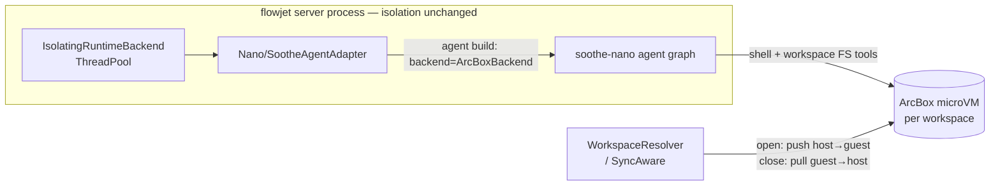

# RFC-005: ArcBox Tool Sandbox (soothe-nano 2.0)

- **Kind**: Architecture Design
- **Status**: Draft
- **Created**: 2026-10-18
- **Depends on**: [RFC-002](RFC-002-isolated-thread-pool-runtime.md) (AgentRuntime isolation), soothe-nano 2.0 sandbox module

---

## 1. Summary

Tool calls (shell commands and workspace file operations) execute inside a
per-workspace **ArcBox Linux microVM**, driven by soothe-nano 2.0's
[`ArcBoxBackend`](https://github.com/arcboxlabs/arcbox). The AgentRuntime
isolation is unchanged — the agent loop, LLM calls, and credentials stay on
thread-pool workers in the server process; only the *execution surface* moves
into the guest.

This replaces (and removes) the previous `FLOWJET_ISOLATION_MODE=arcbox`
whole-worker-in-VM isolation mode: running the entire pool worker inside a
microVM duplicated soothe-nano's sandbox capability at the wrong layer.

## 2. Motivation

- **Blast radius**: an agent `run_command` on the host can reach the server
  process' filesystem, env, and network. A microVM boundary caps tool
  execution at a disposable Linux guest with only the staged workspace.
- **Right layer**: soothe-nano 2.0 already provides sandbox-aware tool
  routing (shell → `backend.execute`, workspace FS → guest, framework state →
  host) and placement policy (`sandbox:` config section). Flowjet should bind
  that backend instead of re-implementing confinement around the whole worker.
- **Workspace sync stays intact**: the host workspace directory remains the
  integration point (fsspec sync, backend materials); staging sandwiches the
  guest transfer into the existing session lifecycle.

## 3. Non-goals

- Per-session guest isolation: the sandbox is **per workspace**. Concurrent
  sessions sharing one workspace share one guest (staged serially; a peer
  mid-run skips the host push so live guest state is never clobbered).
- Incremental (delta) transfers: staging is a full-tree push/pull with a
  `(size, mtime_ns)` manifest skip for unchanged files.

> **Revision (2026-10-21, RFC-RD-607)**: guest-side deletion propagation is no
> longer a non-goal — `pull` now removes host files that were recorded in the
> last push manifest but disappeared from the guest tree (so agent-side
> deletes flow guest → host → sync checkpoint → content tree). Host files
> created after the push are never in the manifest and can never be deleted
> by this path.

## 4. Configuration

Enabled by a `sandbox:` section in the flowjet nano.yml. Flowjet owns the
lifecycle keys; the remaining keys (`on_deny`, `placement_overrides`,
`max_shuttle_bytes`) belong to soothe-nano's placement policy and pass
through `SootheConfig` unchanged (unknown keys are ignored, so both owners
share the section):

```yaml
sandbox:
  enabled: true              # flowjet: run tool calls in an arcbox container
  image: flowjet-server:2.2  # guest image; must ship python3 + POSIX coreutils
  vcpus: 2
  mem_mib: 2048
  network: true
  workspace_root: /workspace
  default_timeout: 120       # per guest execute, seconds
  connect_timeout: 60
  idle_timeout_seconds: 300  # idle sandbox recycle
  max_sandboxes: 8          # 0 (unlimited), None (70% usable CPU / vcpus, min 8), or int
  orphan_timeout_seconds: null  # daemon-side crash deadline; null → max(900, 3× idle)
  recover_orphans: true        # adopt a surviving VM after a restart
  owner: flowjet               # sandbox label namespace; env FLOWJET_SANDBOX_OWNER
  # FLOWJET_SANDBOX_MAX (int; 0=unlimited) and FLOWJET_SANDBOX_MAX_PERCENT (1-100, default 70) env overrides
  # api_url / api_key: optional; env fallback ARCBOX_API_URL / ARCBOX_API_KEY
  # soothe-nano placement policy (pass-through):
  on_deny: drop              # 'raise' fails closed on unregistered tools
  placement_overrides: {}
  max_shuttle_bytes: 33554432
```

Startup fails loud when the section is enabled but misconfigured (missing
`image`) or the arcbox SDK is absent. Disabled (the default) is byte-for-byte
the previous host-side tools behavior.

## 5. Architecture



- `flowjet.core.sandbox.arbox.ArcBoxToolSandboxManager` — one guest VM
  per workspace: lazy spawn (`AsyncArcBox.create(..., wait_until_ready=True)`),
  idle reaper, LRU eviction at `max_sandboxes` (explicit int, `None`, or `0`
  for unlimited — `None` sizes from host CPU: 70% usable ÷ per-sandbox vCPUs,
  minimum 8; env overrides `FLOWJET_SANDBOX_MAX` and `FLOWJET_SANDBOX_MAX_PERCENT`),
  per-workspace asyncio lock.
- `SandboxAwareWorkspaceResolver` — decorates the existing resolver so staging
  runs inside the session lifecycle: open = inner materialize → host push;
  close = guest pull → inner checkpoint (the sync checkpoint must see guest
  outputs).
- Adapter binding — the sandbox backend is pinned at agent build time, so the
  adapter caches the built agent on **workspace + sandbox id**, not the path
  alone: a respawn, idle recycle or eviction yields a new id and the agent is
  rebuilt (a stale binding fails every guest tool call with `VM not found`). In
  sandbox mode the request's `configurable["workspace"]` is the **guest root**
  (`/workspace`), not the host path — matching soothe-nano sandbox semantics
  (system prompt, workspace policy, and recon all target the guest root).

### 5.1 Readiness invariant

`open_workspace` runs once per turn on the main loop, *before* the agent
streams, and is the only place a guest is created or validated; the sync
`backend_for` (worker threads) never spawns. It guarantees a *usable* guest:

1. **Probe** — two tiers, cheap first. Tier 1 is `sandbox.info()`: one unary
   RPC, "always fresh, never cached", no guest execution, no lifecycle side
   effects — it catches the observed failure class (the daemon's record
   *outliving the VM*: `list()` still says `ready` while every call fails
   with `VM not found`) and terminal states (`stopping`/`stopped`/`failed`).
   Tier 2 is a guest round-trip (`true`), catching a wedged guest (VM
   present, nothing executing); commands run as independent process groups,
   so it never queues behind a peer's long-running command. A record is
   never trusted on its own.
2. **Replace** — a lease that fails the probe is killed and dropped; the
   replacement is seeded from the host tree. In-flight run counts carry over so
   peer open/close pairs stay balanced, and the reseed is forced even with a
   peer mid-run (a new VM is empty — skipping the push is how materials go
   missing).
3. **Reseed** — every path that yields a new guest (spawn, respawn, adoption)
   pushes the host workspace before the turn runs.

Every control-plane RPC in the manager is bounded (`kill` / `set_lifecycle`
by a 15 s deadline, `connect` by `connect_timeout`): the SDK's per-RPC
deadline is opt-in and unconfigured here, and one wedged call would otherwise
stall the reaper loop — a stalled heartbeat reads to the daemon exactly like
a dead owner, which gets *healthy* VMs reaped at their deadlines.

### 5.2 Crash and restart

The manager holds its leases in memory, so a `flowjet-server` crash loses the
map while the daemon keeps the VMs. Three mechanisms keep that safe:

- **Daemon-side orphan deadline** — each VM is created with
  `idle_timeout=<orphan deadline>` + `on_idle="kill"`; the manager
  *re-arms* that timer every `_HEARTBEAT_INTERVAL_SECONDS` (60 s, one
  bounded `set_lifecycle` per lease). Expiry therefore means "the owning
  process is gone", and the daemon reaps the VM with no cross-process
  coordination and no startup kill-list. A lease that cannot be re-armed is
  unreachable and is dropped immediately. The deadline defaults to
  `max(900, 3 × idle_timeout_seconds)` when unset, so an existing config with
  a long idle reaper parses unchanged and is never preempted by a daemon
  kill; an explicit value must exceed `idle_timeout_seconds` (validated only
  when the sandbox is enabled).
- **Startup scan + adoption** — on first use the manager lists owner-scoped
  sandboxes carrying its labels (`flowjet.sandbox{,-owner,-instance,-workspace}`).
  Entries from another instance are recovery *candidates*, not victims: the
  first turn for that workspace connects, probes, then **pulls guest → host**
  (recovering files the interrupted turn wrote but never pulled) before pushing
  the host tree back. No candidate (or a dead one) falls through to a fresh,
  seeded VM. `recover_orphans: false` disables adoption.
- **Owner scoping** — `owner` namespaces the labels so several flowjet planes
  sharing one daemon never adopt or reap each other's sandboxes. Adoption
  additionally assumes one process per workspace at a time (the shipped
  agentspace plane runs a single replica).

A failing `create` reconnects the client and retries once, covering a daemon
that is itself restarting.
- Credential boundary — LLM keys and the nano config never enter the guest;
  only the staged workspace bytes do.

## 6. Removed: whole-worker arcbox isolation

`FLOWJET_ISOLATION_MODE=arcbox` (arcbox_vm_pool / arcbox_worker /
arcbox_protocol — an entire pool worker running inside a VM) is deleted:
`isolation_mode` and all `FLOWJET_ARCBOX_*` settings are gone, and the thread
pool is the only isolation pool. The arcbox SDK dependency stays (the tool
sandbox uses it).

## 7. Consequences

- `run_command`-style tools no longer see the host FS, host env, or host
  network beyond the sandbox's `network` setting.
- Adds per-request staging cost proportional to workspace size on first open
  (and on host-side changes); the manifest makes steady-state transfers no-op.
- Host-side `~/.flowjet` state (memories, framework state) routes back to the
  host via soothe-nano's `CompositeBackend` — unchanged behavior.
