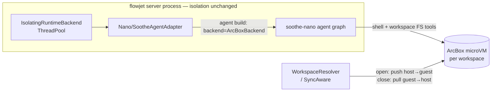

# RFC-005: ArcBox Tool Sandbox (soothe-nano 2.0)

- **Kind**: Architecture Design
- **Status**: Draft
- **Created**: 2026-10-18
- **Depends on**: [RFC-002](RFC-002-isolated-thread-pool-runtime.md) (AgentRuntime isolation), soothe-nano 2.0 sandbox module

---

## 1. Summary

Tool calls (shell commands and workspace file operations) execute inside a
per-workspace **ArcBox Linux microVM**, driven by soothe-nano 2.0's
[`ArcBoxBackend`](https://github.com/arcboxlabs/arcbox). The AgentRuntime
isolation is unchanged — the agent loop, LLM calls, and credentials stay on
thread-pool workers in the server process; only the *execution surface* moves
into the guest.

This replaces (and removes) the previous `FLOWJET_ISOLATION_MODE=arcbox`
whole-worker-in-VM isolation mode: running the entire pool worker inside a
microVM duplicated soothe-nano's sandbox capability at the wrong layer.

## 2. Motivation

- **Blast radius**: an agent `run_command` on the host can reach the server
  process' filesystem, env, and network. A microVM boundary caps tool
  execution at a disposable Linux guest with only the staged workspace.
- **Right layer**: soothe-nano 2.0 already provides sandbox-aware tool
  routing (shell → `backend.execute`, workspace FS → guest, framework state →
  host) and placement policy (`sandbox:` config section). Flowjet should bind
  that backend instead of re-implementing confinement around the whole worker.
- **Workspace sync stays intact**: the host workspace directory remains the
  integration point (fsspec sync, backend materials); staging sandwiches the
  guest transfer into the existing session lifecycle.

## 3. Non-goals

- Per-session guest isolation: the sandbox is **per workspace**. Concurrent
  sessions sharing one workspace share one guest (staged serially; a peer
  mid-run skips the host push so live guest state is never clobbered).
- Guest-side deletion propagation: a host file deleted between sessions is
  not removed from the guest (the pull direction is authoritative at close).
- Incremental (delta) transfers: staging is a full-tree push/pull with a
  `(size, mtime_ns)` manifest skip for unchanged files.

## 4. Configuration

Enabled by a `sandbox:` section in the flowjet nano.yml. Flowjet owns the
lifecycle keys; the remaining keys (`on_deny`, `placement_overrides`,
`max_shuttle_bytes`) belong to soothe-nano's placement policy and pass
through `SootheConfig` unchanged (unknown keys are ignored, so both owners
share the section):

```yaml
sandbox:
  enabled: true              # flowjet: run tool calls in an arcbox container
  image: flowjet-server:2.2  # guest image; must ship python3 + POSIX coreutils
  vcpus: 2
  mem_mib: 2048
  network: true
  workspace_root: /workspace
  default_timeout: 120       # per guest execute, seconds
  connect_timeout: 60
  idle_timeout_seconds: 300  # idle sandbox recycle
  max_sandboxes: 4           # live VM cap (LRU idle eviction)
  # api_url / api_key: optional; env fallback ARCBOX_API_URL / ARCBOX_API_KEY
  # soothe-nano placement policy (pass-through):
  on_deny: drop              # 'raise' fails closed on unregistered tools
  placement_overrides: {}
  max_shuttle_bytes: 33554432
```

Startup fails loud when the section is enabled but misconfigured (missing
`image`) or the arcbox SDK is absent. Disabled (the default) is byte-for-byte
the previous host-side tools behavior.

## 5. Architecture



- `flowjet.core.backends.tool_sandbox.ArcBoxToolSandboxManager` — one guest VM
  per workspace: lazy spawn (`AsyncArcBox.create(..., wait_until_ready=True)`),
  idle reaper, LRU eviction at `max_sandboxes`, per-workspace asyncio lock.
- `SandboxAwareWorkspaceResolver` — decorates the existing resolver so staging
  runs inside the session lifecycle: open = inner materialize → host push;
  close = guest pull → inner checkpoint (the sync checkpoint must see guest
  outputs).
- Adapter binding — the sandbox backend is bound at agent build time; the
  adapter rebuilds its agent when the pool worker switches workspaces. In
  sandbox mode the request's `configurable["workspace"]` is the **guest root**
  (`/workspace`), not the host path — matching soothe-nano sandbox semantics
  (system prompt, workspace policy, and recon all target the guest root).
- Credential boundary — LLM keys and the nano config never enter the guest;
  only the staged workspace bytes do.

## 6. Removed: whole-worker arcbox isolation

`FLOWJET_ISOLATION_MODE=arcbox` (arcbox_vm_pool / arcbox_worker /
arcbox_protocol — an entire pool worker running inside a VM) is deleted:
`isolation_mode` and all `FLOWJET_ARCBOX_*` settings are gone, and the thread
pool is the only isolation pool. The arcbox SDK dependency stays (the tool
sandbox uses it).

## 7. Consequences

- `run_command`-style tools no longer see the host FS, host env, or host
  network beyond the sandbox's `network` setting.
- Adds per-request staging cost proportional to workspace size on first open
  (and on host-side changes); the manifest makes steady-state transfers no-op.
- Host-side `~/.flowjet` state (memories, framework state) routes back to the
  host via soothe-nano's `CompositeBackend` — unchanged behavior.
